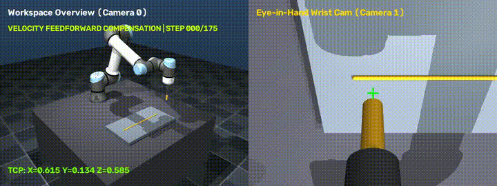
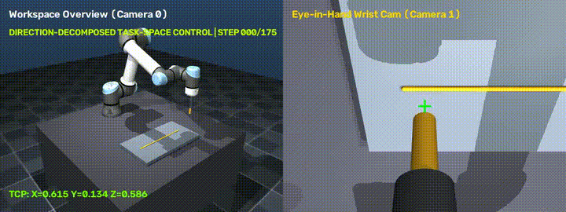
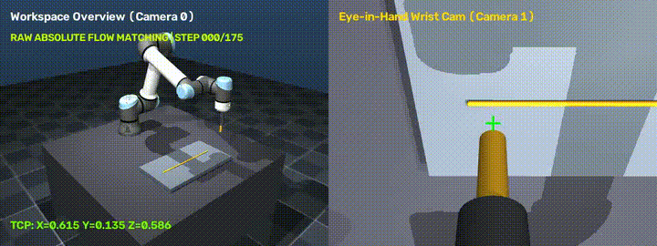
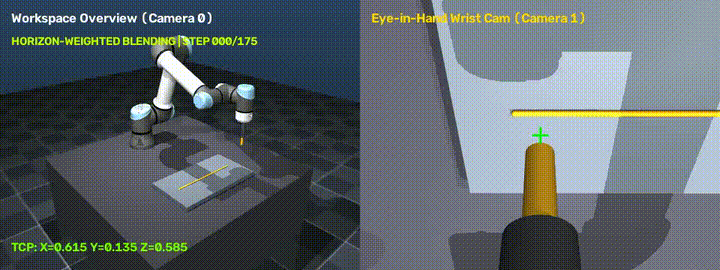

# Robotics & Embodied AI Engineering: UR5e Seam Welding (`ur5e-embodied-ai-welding`)

This repository serves as a complete Embodied AI & Robotics engineering codebase and curriculum for industrial robotic manipulation, featuring a **DeepMind UR5e MuJoCo Industrial Workcell**, **Conditional Flow Matching Action-Chunking Policies**, and a **5-Way Action Ensembling & Trajectory Execution Benchmark**.

---

## Visual Rollout Showcase ($320\text{ mm}$ Seam @ $25\text{ Hz}$)

| **Velocity Feedforward Compensation** (`324.7 mm` Span \| `7.38 mm` Error) | **Direction-Decomposed Task-Space $J^\dagger$** (`325.4 mm` Span \| `7.91 mm` Error) |
| :---: | :---: |
|  |  |

| **Raw Absolute Flow Matching** (`319.2 mm` Span \| `7.44 mm` Error) | **Horizon-Weighted Blending** (`321.3 mm` Span \| `8.51 mm` Error) |
| :---: | :---: |
|  |  |

### Action Ensembling Benchmark Results (`exercises/09_action_ensembling_benchmark.py`)

| Execution Strategy | Active $Y$ Range ($\text{mm}$) | Seam Span | Mean Cross-Track Error | Active Weld Steps |
| :--- | :---: | :---: | :---: | :---: |
| **Velocity Feedforward Compensation** | `[-159.9, +164.8]` | **`324.7 mm`** | **`7.38 mm` (Best)** | `98` |
| **Direction-Decomposed Task-Space Control ($J^\dagger$)** | `[-160.8, +164.6]` | **`325.4 mm`** | **`7.91 mm`** | `99` |
| **Raw Absolute Flow Matching** | `[-158.4, +160.7]` | **`319.2 mm`** | **`7.44 mm`** | `108` |
| **Horizon-Weighted Blending** | `[-156.5, +164.8]` | **`321.3 mm`** | **`8.51 mm`** | `105` |
| **Endpoint-Anchored Trajectory Bridge** | `[-155.5, +163.3]` | **`318.8 mm`** | **`7.90 mm`** | `110` |

---

## 1. Environment & Hardware Specifications

- **Virtual Environment:** `robots/` (managed via `uv`)
- **Python Version:** `3.14.8`
- **GPU Acceleration:** NVIDIA GeForce GTX 1080 Ti (11 GB VRAM, Compute Capability 6.1)
- **Deep Learning Framework:** `PyTorch 2.14.1+cu126` (with CUDA runtime)
- **Physics Simulator:** `MuJoCo 3.17.0` (with hardware-accelerated EGL offscreen rendering)
- **Computer Vision & Robotics Tooling:** `opencv-python-headless`, `einops`, `h5py`, `zarr`, `scipy`, `numpy`

### Quick Commands

```bash
# Verify environment (PyTorch CUDA, MuJoCo stepping, and EGL offscreen rendering)
robots/bin/python verify_env.py

# Run spatial math & coordinate frame transform module
robots/bin/python src/01_spatial_math/transforms.py

# Run the UR5e industrial seam welding simulation with dual-camera video recording
robots/bin/python src/02_mujoco_sim/robot_arm.py
```

---

## 2. Completed Modules & Workcell Architecture

```
Robotics/
├── verify_env.py               # Hardware & library verification test
├── robots/                     # Python 3.14 virtual environment (uv)
├── models/
│   ├── ur5e/
│   │   ├── workcell.xml        # Industrial workcell (table, welding workpiece, dual cameras)
│   │   ├── ur5e.xml            # DeepMind official UR5e model with custom welding torch & TCP
│   │   └── assets/             # Precision CAD meshes & collision geometries
│   └── industrial_arm.xml      # Simplified primitive 6-DOF arm reference model
├── src/
│   ├── 01_spatial_math/
│   │   └── transforms.py       # SE(3), SO(3), Quaternions, Homogeneous Transforms
│   └── 02_mujoco_sim/
│       └── robot_arm.py        # UR5e Industrial Workcell with Closed-Loop DLS-IK & Multi-Cam Dashboard
├── exercises/
│   ├── 01_spatial_math_exercise.py
│   ├── 02_kinematics_jacobian_exercise.py
│   ├── 03_mujoco_fundamentals_exercise.py
│   ├── 04_teleop_data_collection.py
│   ├── 05_record_welding_demos.py
│   ├── 06_visuomotor_policy_training.py
│   ├── 07_closed_loop_rollout.py
│   ├── 08_flow_matching_policy.py
│   └── 09_action_ensembling_benchmark.py
├── scripts/
│   ├── render_falling_sphere.py
│   └── rollout_flow_matching.py
├── outputs/                    # Trained checkpoints (.pt), MP4/GIF rollouts, and HTML benchmark player
└── data/                       # Teleoperation demonstration datasets (HDF5)
```

---

## 3. Key Robotics Engineering Concepts Implemented

### A. Closed-Loop Differential Inverse Kinematics (DLS-IK)
- **Damped Least Squares (Levenberg-Marquardt):**
  $$\Delta q = J^T (J J^T + \lambda^2 I)^{-1} e_{\text{cartesian}}$$
  Prevents unbounded velocity spikes near kinematic singularities.
- **Joint Limit Enforcement:** Clamps joint angles to physical mechanical limits at each solver iteration.
- **Closed-Loop Feedback:** Compensates for dynamic compliance and gravity droop without needing slow iterative convergence inside the high-rate physics loop.

### B. Multi-Camera Rig for Visuomotor Policies
- **Workspace Overview Camera (`workspace_cam`):** Third-person perspective capturing global workcell context and target object locations.
- **Eye-in-Hand Wrist Camera (`wrist_cam`):** Mounted on the tool flange directly above the Tool-Center-Point (TCP) with an alignment crosshair, essential for fine industrial dexterity.
- **Synchronized Offscreen Pipeline:** Rendered at 30 FPS using hardware EGL acceleration directly to `outputs/ur5e_welding_demo.mp4`.

---

## 4. Core Industrial Robotics & Embodied AI Concepts

| Concept | Industrial Robotics Application | Where It's Implemented |
|---|---|---|
| **$SE(3)$ Math & Transforms** | Tracking objects across camera frames into robot base frame. | [`src/01_spatial_math/transforms.py`](src/01_spatial_math/transforms.py) |
| **Jacobian Kinematics** | Translating human teleoperation input (VR controller / 3D mouse) to joint commands. | [`UR5eIndustrialWorkcell.solve_ik`](src/02_mujoco_sim/robot_arm.py) |
| **Singularity Avoidance** | Preventing joint explosion when the arm extends near full reach. | Damped Least Squares regularization ($\lambda^2 I$) |
| **Eye-in-Hand Vision** | Training visuomotor diffusion and flow matching policies to follow welds, turn valves, and seat bolts. | Dual-camera rendering pipeline in [`robot_arm.py`](src/02_mujoco_sim/robot_arm.py) |
